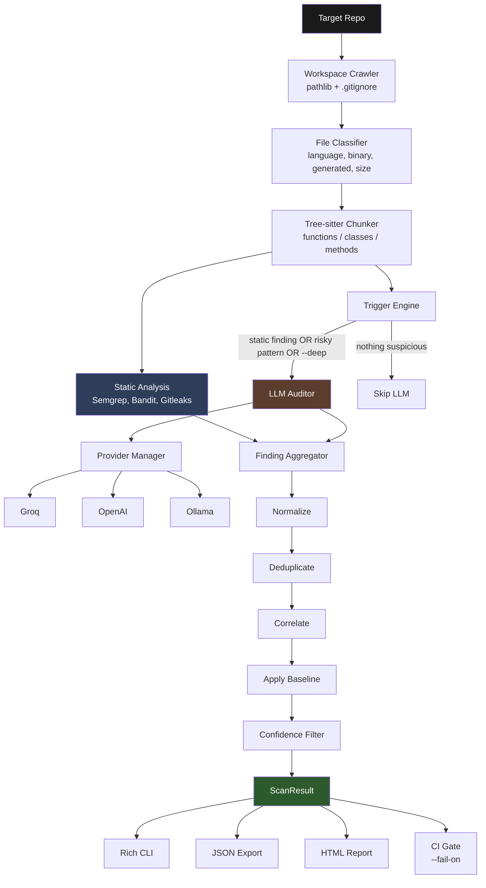

# AegisScan — AI-Driven Workspace Security & Optimization Scanner

**Status:** Architecture frozen. Execution-driven from here.
**Core principle:** Deterministic tools detect; AI reasons, explains, correlates, and suggests fixes.

---

## 1. Goal

AegisScan analyzes a source-code workspace for:

- Security vulnerabilities (secrets, injection, auth issues, unsafe crypto, etc.)
- Performance / optimization issues (N+1 queries, algorithmic complexity, poor caching, etc.)

The scanner must work without a local GPU and must remain useful even when the LLM is unavailable.

---

## 2. Non-negotiable design rules

1. **Static analysis first.** The LLM is never the primary detector — it reasons, explains, correlates, and suggests fixes on top of deterministic findings.
2. **Provider independence.** The LLM auditor talks to a `ProviderManager`, never directly to Groq/OpenAI/Ollama. Swapping providers must never require rewriting the auditor.
3. **Pydantic everywhere.** Every module boundary passes typed models (`FileInfo`, `CodeChunk`, `Finding`, `ScanResult`) — never raw dicts.
4. **Evidence-based findings.** Every finding carries file, line range, evidence snippet, explanation, and (if applicable) suggested fix.
5. **Confidence ≠ severity.** They are independent axes. A `Critical` finding with `confidence: 0.6` means "potentially severe, not yet trustworthy" — not "ignore" and not "alarm."
6. **Graceful degradation.** If Tree-sitter, Semgrep, or the LLM provider fails or is unavailable, the scanner still produces a valid report (falling back to generic chunking / remaining static tools / static-only mode respectively).
7. **No LangChain (for now).** The actual pipeline (chunk → prompt → provider → JSON → Pydantic) doesn't need it. Reconsider only if a concrete need (agent workflows, retrieval) appears.
8. **No code leaves the machine unredacted.** Any path that sends source to an external LLM provider must pass through a secret-redaction step first — even a minimal regex-based redactor counts. The full privacy-mode system (`--privacy strict|redact|standard`) isn't built until V6, but the *rule* applies from the moment V2 makes its first real Groq call:
   ```
   External LLM transmission → Secret redaction → Provider
   ```
   Don't architect V2 in a way that has to be retrofitted to insert this step later.

---

## 3. Final architecture (reference — not a build order)

```
Target Repo
   ↓
Workspace Crawler (pathlib + .gitignore)
   ↓
File Classifier (language, binary, generated, size)
   ↓
Tree-sitter Chunker (functions / classes / methods)
   ↓
   ├── Static Analysis (Semgrep, Bandit, Gitleaks)
   └── Trigger Engine → LLM Auditor → Provider Manager → [Groq | OpenAI | Ollama]
   ↓
Finding Aggregator (normalize, dedup, correlate, confidence, baseline)
   ↓
ScanResult
   ↓
Rich CLI / JSON / HTML report / CI gate
```

### Flow diagram



### Core models

- **FileInfo** — what the crawler discovers (path, language, size, line count, is_binary, is_generated)
- **CodeChunk** — a semantic unit from Tree-sitter (file, symbol name/type, line range, code, imports)
- **Finding** — the universal contract (id, file, issue_type, category, severity, confidence, evidence, explanation, suggested_fix, rule_source, provider, model)
- **ScanResult** — top-level output (scan metadata, counts, scores, `list[Finding]`)

### Correlation semantics (decided, not yet implemented)

Two findings may correlate only when **both** hold:
- Location similarity (same file, overlapping/adjacent lines)
- Semantic similarity (same or closely related category)

Location overlap alone is **not** sufficient — e.g. a Semgrep "SQL Injection" and an LLM "inefficient SQL query" finding on the same line must stay separate.

---

## 4. Versioned roadmap

Each version is a real, runnable milestone — not a checklist item.

### V0 — Workspace Foundation *(current focus)*

- Pydantic models: `FileInfo`, `CodeChunk`, `Finding`, `ScanResult`
- Workspace crawler (pathlib-based directory walk)
- `.gitignore`-aware ignore rules
- File classifier (language, binary, generated, oversized)
- Tests: nested `.gitignore`, empty repo, permission errors, binary files, huge files, Unicode filenames

**Definition of done:**
```bash
aegisscan ./some-real-repo
```
reliably prints a file inventory (discovered / ignored / analyzed, per-language breakdown, binary/generated/oversized counts) against several real repositories.

No Groq, LangChain, Tree-sitter, Semgrep, Bandit, Gitleaks, Provider Manager, concurrency, HTML, scoring, YAML config, or CI yet.

---

### V1 — Static Intelligence

- Tree-sitter chunking (Python, JavaScript, TypeScript, SQL to start)
- Semgrep integration
- Bandit integration
- Gitleaks integration
- Normalize all static tool output into `Finding`
- **Initial evaluation benchmark** — build `examples/vulnerable_python/` and `examples/clean_project/` now (see §7) and run the static engine against them. This gives you a real precision/recall baseline *before* the LLM is introduced, so in V2 you can measure whether the LLM actually improves detection rather than just producing prettier explanations.

**Goal:** the scanner produces real, evidence-backed findings with zero LLM/API dependency, and you have a measured baseline to compare V2 against.

---

### V2 — AI Reasoning

- `LLMProvider` interface (abstract)
- Groq provider (single credential)
- Trigger engine: LLM runs only on chunks with a static finding, a risky pattern, or `--deep` mode
- Prompt template + strict JSON output contract
- Pydantic validation of LLM responses (retry/repair on invalid JSON)
- Confidence bucketing (≥0.90 confirmed, 0.75–0.89 strong, 0.60–0.74 needs review, <0.60 suppressed by default)

**Goal:** `Static finding → LLM reasoning → validated Finding`, using one provider, one credential.

---

### V3 — Intelligence Layer

- Deduplication (file + line overlap + category)
- Correlation (location **and** semantic similarity — see §3)
- Baseline / suppression (`.security-baseline.json`)
- Context builder: one-hop caller/callee + imports for cross-function vulnerability chains

**Goal:** raw findings from multiple sources collapse into a clean, non-redundant final list.

---

### V4 — Developer Experience

- Rich CLI report (summary table + per-finding detail)
- JSON export (`aegisscan-results.json`)
- HTML report (Jinja2 dashboard)
- Security Score and Optimization Score — **only introduced here**, once real findings exist to calibrate weights against. Ship with an explicit `# TODO: uncalibrated` marker until benchmarked.

---

### V5 — Scale

- `ProviderManager`: credential pool, rate limiter, async worker queue
- Multi-provider fallback (Groq → OpenAI → Ollama → static-only)
- Usage tracking: requests, tokens, latency, 429s, per-provider/model
- Note: pooling exists for **resilience and quota management**, not to circumvent a single provider's rate limits — verify Groq's ToS before running multiple credentials in parallel.

---

### V6 — CI / Production

- Git diff–based incremental scanning (`--changed-only`)
- GitHub Actions workflow (PR-triggered static scan, optional LLM pass)
- Severity-based CI gates (`--fail-on security:high`, `--fail-on optimization:medium`)
- Historical scan tracking
- Secret redaction before any code leaves the machine (`--privacy strict|redact|standard`)

---

## 5. CLI surface (target, not all needed for V0)

```bash
aegisscan .                          # static + LLM on suspicious chunks
aegisscan . --deep                   # LLM on all eligible chunks
aegisscan . --static-only            # no API dependency
aegisscan . --security-only          # skip optimization findings
aegisscan . --changed-only           # git-diff incremental (V6)
aegisscan . --format json|html
aegisscan . --fail-on security:high
aegisscan . --privacy strict|redact|standard
```

---

## 6. Project structure (target shape)

```
aegisscan/
├── scanner/
│   ├── ingestion/      # crawler, classifier, ignore rules
│   ├── chunking/        # tree-sitter + per-language chunkers
│   ├── static_analysis/ # semgrep, bandit, gitleaks wrappers
│   ├── llm/              # auditor, prompts, schemas, context builder
│   ├── providers/       # provider interface, manager, groq/openai/ollama
│   ├── aggregation/      # merger, dedup, correlation, confidence, baseline
│   ├── reporting/        # cli, html, templates
│   ├── models/            # finding.py, scan.py, chunk.py
│   └── config.py          # NOT created in V0 — introduced only once a real
│                            #   configuration need exists (see §4, V1+)
├── tests/
├── examples/
│   ├── vulnerable_python/
│   ├── vulnerable_js/
│   └── clean_project/
├── .github/workflows/
├── main.py
├── pyproject.toml
├── .env.example
├── .security-baseline.json
└── README.md
```

---

## 7. Evaluation strategy (don't skip this)

Build `examples/vulnerable_python/` and `examples/clean_project/` as a fixed benchmark starting in **V1** (see V1 milestone above) — not deferred to later. Track against it:

- Precision / recall / false-positive rate
- Confidence calibration (does "0.8 confidence" actually mean ~80% correct?)
- JSON validity rate
- Latency per chunk

This is what turns "I built an AI scanner" into a project with a measurable, defensible quality claim.

---

## 8. Operating rule from here

**No further architecture discussion until V0 has run against a real repository.**

Immediate next files to write:

```
scanner/models/finding.py
scanner/models/scan.py
scanner/models/chunk.py
scanner/ingestion/crawler.py
scanner/ingestion/classifier.py
tests/test_crawler.py
main.py
```

Once `aegisscan ./some-real-repo` reliably produces a correct inventory, move to V1 — not before.
