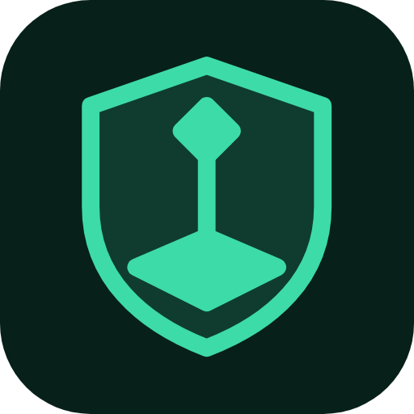

<p align="center"></p>

# AegisScan — AI-Driven Workspace Security & Optimization Scanner

> **AegisScan** is a hybrid multi-layered security pipeline combining deterministic static analysis (Bandit, Semgrep, GitLeaks) with structured LLM AI reasoning (Groq) to analyze codebases for security vulnerabilities, secrets, and performance anti-patterns.

---

## 🌟 Key Architecture & Pipeline Features

AegisScan operates through a 10-stage hybrid analysis pipeline:

1. **Ingestion & Classification**: Fast workspace crawling with `.gitignore` compliance, file classifier for binary/generated/oversized files, and per-language Tree-sitter AST chunking.
2. **Deterministic Static Analysis**: Concurrent multi-tool execution using `Bandit`, `Semgrep`, and `GitLeaks`.
3. **AI Triggering & Secret Redaction**: Selective triggering rules (risky patterns, static findings, or `--deep` pass) with regex-based multi-mode secret scrubbing (`--privacy standard|redact|strict`).
4. **Resilient LLM Provider**: `Groq` cloud LLM with model-level failover, token-bucket rate limiting and exponential backoff, then a graceful static-only fallback.
5. **AI Fix Patch Generator**: Automatic prompt engineering for high-confidence security findings to output production-ready unified `git diff` patches (`--generate-patches`).
6. **Intelligence Layer**: Location & category deduplication, multi-tool correlation confidence boosting, and baseline suppression (`--save-baseline FILE` / `--baseline FILE`).
7. **Scoring & Reporting**: "Midnight Obsidian" dark-mode HTML reports with SVG score gauges, inline AI diff patches, JSON export, and rich CLI terminal summary.
8. **CI/CD Integration**: Incremental Git diff scanning (`--changed-only`, or `--changed-since REF` for a clean CI checkout) and build gate enforcement (`--fail-on security:high`).
9. **SQLite Scan History Persistence**: Automatic recording of scan results, security score trends, and score delta tracking (`aegisscan --history`).
10. **Interactive Web Server**: Built-in zero-dependency local dashboard web server (`aegisscan --server --port 8000`).

---

## 🚀 Quick Start

### Installation

```bash
# Clone repository
git clone https://github.com/KULLOLLITARUN/aegisscan.git
cd aegisscan

# Create virtual environment and install AegisScan as a global executable CLI
python -m venv .venv
source .venv/bin/activate  # On Windows: .venv\Scripts\activate
pip install -e .
```

### Environment Setup

Copy `.env.example` to `.env` and add your Groq API key:

```env
GROQ_API_KEY=gsk_your_groq_api_key_here
```

*(If no API key is provided, AegisScan automatically falls back to static-only mode).*

---

## 🛠️ CLI Usage & Flags

```bash
# Global CLI command
aegisscan .

# Run LLM pass on ALL eligible code chunks
aegisscan . --deep

# Generate AI Unified Git Diff Fix Patches for findings
aegisscan . --generate-patches

# Launch Interactive Web Dashboard Server on port 8000
aegisscan --server --port 8000

# View SQLite Scan History & Score Deltas
aegisscan --history

# Static analysis only (offline mode, no API dependencies)
aegisscan . --static-only

# Incremental scan (only git modified/staged/untracked files; the static tools read just those files)
aegisscan . --changed-only

# Same, plus everything committed since a ref (a CI checkout is clean, so --changed-only alone sees nothing)
aegisscan . --changed-since origin/main

# CI Gate (fail pipeline with exit code 2 if High/Critical security findings exist)
aegisscan . --fail-on security:high

# Secret redaction privacy level before sending code to LLM
aegisscan . --privacy standard   # Scrub secrets, API keys, passwords
aegisscan . --privacy redact     # standard + scrub emails & IP addresses
aegisscan . --privacy strict     # redact + mask all string literals

# Generate Midnight Obsidian HTML Report with inline AI patch diffs
aegisscan . --html report.html

# Output raw JSON ScanResult
aegisscan . --json

# Run Precision/Recall Calibration Benchmark Suite
aegisscan --benchmark
```

---

## 🖥️ Web Dashboard

The React dashboard's build output (`scanner/server/dist`) is **not committed**. Build it once, then start the server:

```bash
cd ui
npm ci
npm run build          # writes scanner/server/dist (inside the Python package, so wheels include it)
cd ..
aegisscan --server --port 8000
```

Without the build the server still starts and serves a basic fallback page, and prints a reminder. Requires Node 22+ (Vite 8). For frontend work run `npm run dev` (port 5173, proxies `/api` to `127.0.0.1:8000`). CI lints and builds the UI on every push and uploads it as the `aegisscan-ui-dist` artifact.

> **Windows:** `npm run ...` fails if the project path contains `&` (for example `Security_&_Optimization`) because `cmd.exe` splits on it. Use a path without `&`, or call the tools directly: `node node_modules/vite/bin/vite.js build` and `node node_modules/oxlint/bin/oxlint src`.

### The survey console

The dashboard is a single "survey console" (design source: `Plans/ui_redesign_v3.html`) with Day (pale spruce glass) and Night (deep spruce) themes. The choice is remembered in the browser and defaults to your system setting.

- **Command bar:** target path, Deep, Static only, privacy level, Run scan, and the theme switch. Patch generation and the Groq API key sit under **More**.
- **Left rail:** Scan, Findings, Files, History and Logs. The Findings badge counts critical and high findings.
- **Scan canvas:** a CSS 3D floor plan with one tile per file that has findings and one pin per finding. Pin height is confidence. Severity is shown by colour **and** shape: critical is a diamond, high a square, medium a triangle, low a hollow square. Drag or use the arrow keys to turn it, scroll or `+`/`-` to zoom. Selecting a finding moves the camera to its tile.
- **Verdict block:** security score, a one-sentence verdict, the change since the previous scan of the same target (from `/api/history`), and the optimization score.
- **Timeline:** follows the live scan, then replays it at 4x. Drag the track or use the arrow keys, `Home`, `End` and `Space` to scrub. Segments and markers come from the progress and log events the stream reported. Under `prefers-reduced-motion` the replay does not auto-play.
- **Inspector:** *Findings* (search, severity chips, sort), *Evidence* (syntax colouring, suggested fix or patch, Copy patch) and *Activity* (the live SSE log).
- **Findings, Files and Logs pages:** the full finding table with filters and paging, a per-file view, and the complete log. Clicking a finding opens the same evidence view in a dialog. History lists past scans from the SQLite database.

The server only scans inside the project folder plus any folders in `AEGISSCAN_ALLOWED_ROOTS`. Scanning a folder outside that list shows an explanation and a "Change target" button instead of a retry. On Windows, `run_aegisscan.bat --allow "D:\path\to\folder"` adds a folder for that run (repeatable; `run_aegisscan.bat [--rebuild] [--allow "folder"] [--allow-any] [port]`). To scan any folder, set `AEGISSCAN_ALLOW_ANY_PATH=1` or pass `--allow-any`; it is off by default, the server prints a warning when it is on, and the localhost-only `Host`/`Origin` checks still apply.

Every region has loading, empty and error states. All numbers come from the scan result or `/api/history`; nothing is estimated.

**Known limits.** The API returns the findings but not the full file list, so the floor shows only files that have findings, sized by the highest line a finding reaches. Other analysed files appear as a count. The canvas draws at most the 48 most severe findings and notes how many more are in the queue. The server does not store full scan results or phase timings: after a page reload the canvas is empty until you run a scan, and the timeline is only recorded for scans run in the current browser session.

### Hosting it (Render or any Docker host)

A public server cannot read a visitor's `C:` or `D:` drive, so **hosted mode** replaces the path box with two ways to supply code, and locks the server down. Local mode (above) is unchanged.

- **Folder:** the browser picks any folder, drops dependencies, build output, binaries and files over 1 MB, zips the rest in the page and uploads it (default limit 50 MB zipped, 5,000 files). The server unpacks it into a private temporary folder, scans only that folder, and deletes it after 30 minutes (so a re-scan does not re-upload).
- **Git URL:** public `https://` repositories only. The server clones it shallowly into a temporary folder, scans it and deletes it right after the scan. Private and internal addresses are refused, as are non-https URLs, embedded credentials, other ports and redirects.
- **Access:** every API call needs `Authorization: Bearer <AEGISSCAN_ACCESS_TOKEN>`. The UI asks for the token once and keeps it in the browser tab's session storage. The server will not start in hosted mode without a token of 16+ characters.
- **Isolation:** server paths never reach the browser (results show `owner-repo` or the folder name, with paths relative to the code). There is no shared scan history, and a key typed into the UI is ignored. Scans are static-only by default, so no code is sent to an LLM.
- **Limits:** 2 concurrent scans (others get "busy"), 10 scans and 10 uploads per client per 10 minutes, a 5-minute scan limit, and a 120 s clone limit. These counters live in memory, so run **one instance**.

**Deploy on Render**

1. Push the repository to GitHub or GitLab (Render deploys from a Git remote).
2. In Render choose **New, Blueprint** and select the repo. [render.yaml](render.yaml) creates a Docker web service with a generated `AEGISSCAN_ACCESS_TOKEN` and `/api/health` as the health check.
3. When the first deploy is live, open the service's **Environment** tab, copy the token, and share it only with people who should use the scanner.
4. Semgrep needs real memory. If scans are killed or very slow, move the service to a larger plan.

The image is built from the [Dockerfile](Dockerfile) (Node builds the UI, then Python 3.12 with git and semgrep runs the server as a non-root user). Run it locally with `docker run -p 10000:10000 -e AEGISSCAN_ACCESS_TOKEN=<16+ characters> aegisscan`.

| Setting | Purpose |
|---|---|
| `AEGISSCAN_MODE=hosted` | Turns on hosted mode (the Docker image sets it) |
| `AEGISSCAN_ACCESS_TOKEN` | Required. 16+ characters |
| `PORT` | Port to listen on (Render sets it). Default 10000 in the image |
| `AEGISSCAN_HOST` | Interface to bind. Default `0.0.0.0` in hosted mode |
| `AEGISSCAN_ALLOWED_HOSTS` | Comma-separated extra host names, e.g. a custom domain. `RENDER_EXTERNAL_HOSTNAME` is added automatically |
| `AEGISSCAN_HOSTED_LLM=1` | Allow LLM scans using the server's own `GROQ_API_KEY` (off by default) |
| `AEGISSCAN_MAX_UPLOAD_MB`, `AEGISSCAN_MAX_UNPACKED_MB`, `AEGISSCAN_MAX_FILES`, `AEGISSCAN_SCAN_TIMEOUT_S`, `AEGISSCAN_MAX_CONCURRENT`, `AEGISSCAN_RATE_LIMIT` | Override the limits above |

**Free option: run it on your own PC and share it through a free tunnel.** This uses your PC's full power, including Semgrep, and costs nothing. It is online only while your PC and the script are running.

1. Download `cloudflared-windows-amd64.exe` from the [cloudflared releases](https://github.com/cloudflare/cloudflared/releases/latest), rename it to `cloudflared.exe` and put it in `deploy\tunnel\` (it is git-ignored). No Cloudflare account is needed for quick tunnels.
2. Double-click `share_aegisscan.bat` in the project folder (or run `powershell -ExecutionPolicy Bypass -File deploy\tunnel\start-tunnel.ps1`). It starts the server in hosted mode on `127.0.0.1` only, opens the tunnel, copies the public `https://....trycloudflare.com` address to your clipboard and prints it with a ready-to-send message.
3. The access token is generated on the first run and saved on your PC, encrypted for your Windows account, in `%LOCALAPPDATA%\AegisScan\token.dat` (outside the project). Every later run reuses it, so you only send it to people once. Run `share_aegisscan.bat -NewToken` to replace it, or pass `-Token <16+ characters>` or set `AEGISSCAN_ACCESS_TOKEN` to use your own. Share the address and the token with people you trust, through a private channel, and press Ctrl+C (or close the window) to stop.

The address changes each run. `-NoTunnel` starts only the local server, for testing. Uploads and clones are scanned on your PC, so only share with people you would let upload code to it.

**Things to know before going public.** One shared token is access control, not user accounts: anyone with it can scan. A clone's size is checked after it finishes, and the host name is resolved once for the safety check and again by git, so a hostile DNS server could in principle race that check, which is one more reason to keep the token private. Uploaded folders are kept up to 30 minutes on the instance's temporary disk. Scan time depends on the instance: on a busy development machine a 4-file folder took 108 s while a one-file repository took 12 s, so size the plan from a real test. The Docker image has not been built in the environment this was written in (no Docker there); build it once and run a scan before relying on it.

---

## 🧪 Benchmark & Quality Calibration

`aegisscan --benchmark` scores the scanner against a ground-truth manifest, `examples/benchmark_labels.json`: 55 files (27 clean), 162 labelled issues, written by reading the code rather than from tool output. It includes a CVE-style Python corpus (`examples/benchmark_corpus/`: SQL injection, command injection, deserialization, weak crypto, TLS misuse, hardcoded secrets, plus safe look-alikes), a multi-language corpus (`examples/benchmark_multilang/`: Java, Go, PHP, C# and TypeScript, each a vulnerable file plus a safe twin using the standard fix), and the performance fixtures. The samples are hand-written reductions of well-documented vulnerability patterns (CWE-89, 78, 502, 611, 22, 79, 601, 327, hardcoded credentials), not code copied from real CVEs.

```bash
aegisscan --benchmark --static-only                     # print the report
aegisscan --benchmark --benchmark-json metrics.json     # also write machine-readable metrics
```

It reports precision, recall, false-positive rate (share of clean files flagged), per-source precision, per-category recall, **confidence calibration** (reliability bins, ECE, Brier score) and, for LLM runs, JSON validity rate and latency per request. Recall is counted over the labels that an *active* tool is expected to catch, and separately over all labels.

Measured with Bandit + built-in secret scanner + optimizer (Semgrep off, which is what the test suite gates on):

| Metric | Value |
|---|---|
| Precision | 86.5% (77 TP / 12 FP) |
| Recall, labels in scope | 100% (71 labels) |
| Recall, all labels | 46% (the other 84 need Semgrep or an LLM) |
| Clean files flagged | 3 of 25 |
| Calibration | ECE 0.141, Brier 0.102 |

With Semgrep on (static-only, 162 labels / 55 files) the benchmark gives precision 90.3%, recall 100% over the labels an active tool should catch and 95.7% over all labels, 6 of 27 clean files flagged, ECE 0.122 and Brier 0.092 (the bundled rules carry their own confidence; see `aegis_confidence` in `scanner/static_analysis/rules/`). That run is not gated by tests and depends on the Semgrep registry packs. The ECE gain is partly fitted to this corpus.

Read these as a small-sample baseline, not a quality claim: the corpus is self-authored, and the false positives are mostly Bandit notes on safe code (`import subprocess`, placeholder-built `IN (?,?)` SQL, allow-listed `ORDER BY`) plus Semgrep taint rules that do not understand custom sanitisers or allow-lists (in the TypeScript safe twin). With Semgrep online (network) the last static-only run scored precision 90.3%, recall 100% over the 154 in-scope labels and 95.7% over all 162 (the remaining 7 labels need the LLM pass). The newest bundled rules are taint rules for PHP and JS/TS (`aegis-*-taint-*`: file inclusion, reflected XSS, command injection, path traversal): they follow a request value through a variable inside one file or function, and stop at casts, escaping functions and (PHP) `in_array`/`is_numeric` guards. They do not follow it across files or through function calls, so DVWA's cross-file XSS and file inclusion are still missed; on this benchmark they added one detection (the registry packs already caught the other six taint fixtures), and on Express they added one false positive (taint carried through `.slice()`). AegisScan's bundled rules, one file per language in `scanner/static_analysis/rules/` (`js`, `java`, `go`, `php`, `csharp`), supply much of that. The JS/TS ones in `scanner/static_analysis/rules/js_security.yml` cover eval, `new Function`, `vm`, `document.write`, `innerHTML`, `insertAdjacentHTML`, jQuery `.html()`, React `dangerouslySetInnerHTML`, timers given code strings, string-built SQL and request-driven file paths; the nine labels for the newest rules sit in a fixture written alongside them, so they are not an independent test. Semgrep's registry packs alone (python, javascript, owasp-top-ten, security-audit, nodejsscan) miss 10 of the 32 original labels in the Java/Go/PHP/C#/TypeScript corpus; the bundled Java, Go, PHP and C# rules catch all of those (shell commands built from input, XXE, weak ciphers and hashes, `include`/`unserialize`/`eval`/`extract` on request data, `Process.Start` with concatenated arguments, disabled TLS validation, open redirects, request-driven file paths, `template.HTML`/`HtmlString` XSS). Those 10 are an independent test, written before the rules; the 26 labels in the newest per-language fixtures (`more_sinks.*`, with `safe_more_sinks.*` twins) were written alongside the rules and show they work, not that they generalise. Two live Groq runs were recorded on an earlier, smaller corpus (see `Plans/REMAINING_ISSUES_AND_TESTING.md`, item 7); none since.

---

## 🧪 Automated Testing

AegisScan is protected by a 382-test automated suite (4 opt-in live-provider tests are skipped without credentials) covering crawler logic, tree-sitter chunking, static analysis runners, LLM failover, scoring engines, CI build gates, SQLite persistence, and web server endpoints.

```bash
pytest tests/ -v
# Output: 382 passed, 4 skipped in ~90-120s
```

---

## 🛡️ License

MIT License, free for open-source and commercial use. See [LICENSE](LICENSE).

## Configuration

| Setting | Where | Purpose |
|---|---|---|
| `GROQ_API_KEY` | `.env` / environment | LLM provider (Groq is the only provider; without a key the scan is static-only) |
| `AEGISSCAN_GROQ_MODELS` | environment | Comma-separated Groq model ids (first is the default). Retired/unknown models are skipped automatically |
| `AEGISSCAN_LLM_WORKERS`, `AEGISSCAN_LLM_RPM` | environment | Parallel LLM calls (default 4) and the global requests-per-minute cap (default 10) |
| `AEGISSCAN_ALLOWED_ROOTS` | environment | Extra directories the web server may scan (`;` on Windows, `:` elsewhere). Default: project root only |
| `AEGISSCAN_ALLOW_ANY_PATH` | environment | Set to `1` to let the web server scan any directory (opt-in; off by default). Prefer `AEGISSCAN_ALLOWED_ROOTS` when you can |
| `AEGISSCAN_MODE` | environment | `hosted` switches the web server to uploads and Git URLs behind an access token. See "Hosting it" |
| `exclude_dirs` | `.aegisscan.toml` in the scan target | Directory names skipped by every static tool: Bandit, Semgrep, Gitleaks and the optimizer (tests/ and examples/ are scanned by default) |

Static tools: Bandit and the built-in optimizer ship with the package; install Semgrep with `pip install ".[static]"` and Gitleaks from its [releases page](https://github.com/gitleaks/gitleaks/releases). Missing tools are skipped, never fatal.

**Dependency vulnerabilities (SCA):** if [OSV-Scanner](https://github.com/google/osv-scanner) (v2, Apache-2.0) is on `PATH`, AegisScan runs it over lockfiles and manifests (`requirements.txt`, `package-lock.json`, `go.mod`, `pom.xml`, `Cargo.lock`, …). Findings use `category="dependencies"`, `rule_source="osv"` and point at the line that pins the vulnerable version. It sends package names and versions (never your code) to api.osv.dev, so `--privacy strict` disables it. With `--changed-only` / `--changed-since` it runs only when a lockfile changed.

The web server (`--server`) binds to `127.0.0.1`, sends no CORS headers and rejects non-local `Host`/`Origin` headers.

Tree-sitter chunking covers Python, JavaScript, TypeScript, Go, Java, PHP and C#; other languages (including SQL) use the generic chunker.
